# 대난투 스매시브라더스 for Wii U 한글 패치

일본판 『大乱闘スマッシュブラザーズ for Wii U』(AXFJ01, 타이틀 ID `0005000010110E00`, 업데이트 v304)를 위한 비공식 팬 한글 패치입니다.

**최신: 빌드 23** · [릴리스 다운로드](https://github.com/auseong325-design/ssb-for-wiiu-korean-patch/releases/latest) · [패치 로그(이전 판과 달라진 점)](패치%20로그.md)

| | |
|:---:|:---:|
| 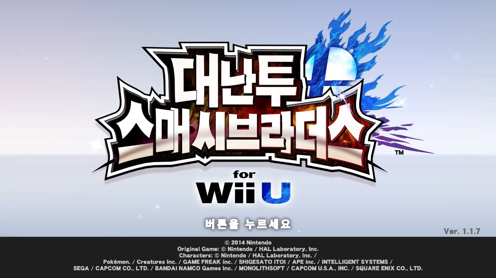 |  |
| 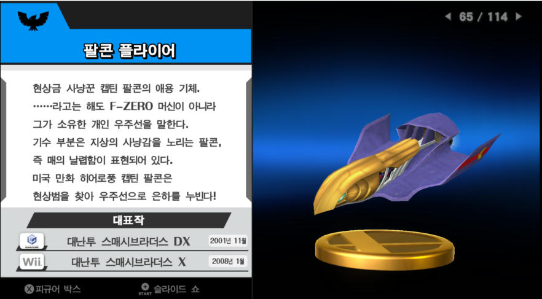 | 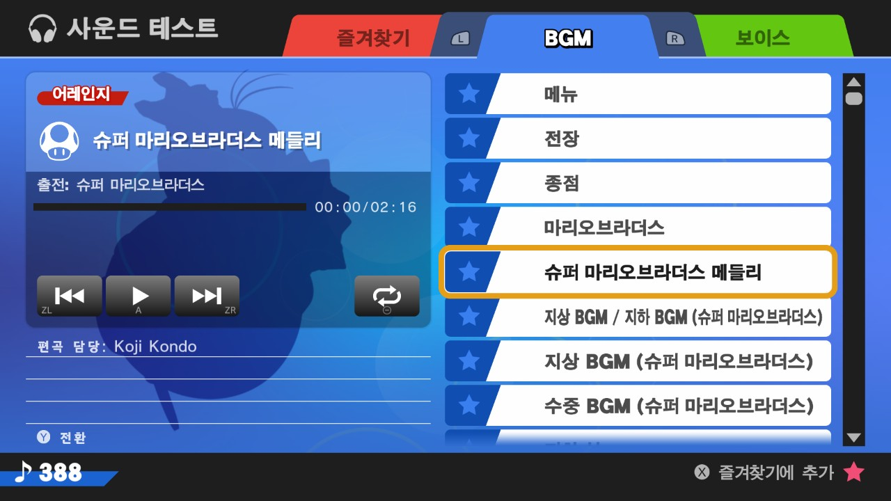 |

## 한글화 범위

- 게임 안의 문장, 메뉴·버튼 그림 속 글자를 한국어로 바꿨습니다. 대난투 로고는 한글 로고입니다.
- 파르테나의 신전 천계만담 대화는 『슈퍼 스매시브라더스 얼티밋』 한국어판 문장에 맞췄습니다.
- 오프닝 영상의 로고 장면과 조작 설명 영상의 이름을 한글로 바꿨습니다(선택).
- Wii U 메뉴의 시작 화면을 한글 로고로, 게임 이름과 전자 설명서를 한국어로 바꿀 수 있습니다(게임 이름·설명서는 선택, 한글 시스템 글꼴이 있는 본체용).
- 음성은 일본어 그대로입니다. DLC가 있어도, 없어도 씁니다.

## 다운로드

| 파일 | 내용 |
|---|---|
| `SmashWiiU_Korean_build23_WiiU.zip` | Wii U 본체용(Aroma). 설치 앱, SDCafiine용 파일, 안내서, 라이선스 |
| `SmashWiiU_Korean_build23_Cemu.zip` | Cemu 그래픽 팩 (Core / Core + DLC / 영상), 일본판 로고 팩 만들기 도구 |

압축을 푼 뒤 안에 있는 `읽어주세요.txt`(Wii U) 또는 `설치 안내.txt`(Cemu)를 따라 주세요. 게임 본편과 업데이트는 들어 있지 않습니다.

## Wii U 설치

필요한 것: [Aroma](https://wiiu.hacks.guide/)가 설치된 Wii U, SD 카드, 일본판 게임과 업데이트 v304.

| 방법 | 설명 |
|---|---|
| 1. 전용 설치 앱 (추천) | SD 카드에 `wiiu` 폴더를 복사하고 Wii U 메뉴의 「Smash Wii U KR Patch」를 실행합니다. 한 번 설치하면 SD 카드 없이도 한글로 나옵니다. |
| 1-USB. 설치 앱 + USB | SD 카드가 작을 때. 설치 앱만 SD 카드에 두고 패치 파일은 USB 저장 장치에서 읽습니다. (새로 추가) |
| 2. SDCafiine | 본체 파일을 바꾸지 않고 SD 카드의 한글 파일을 읽게 합니다. 디스크판은 이 방법을 씁니다. |

자세한 순서는 Wii U ZIP 안의 `읽어주세요.txt`에 있습니다.

## Aroma용 전용 설치 앱

[Wii 스포츠 클럽](https://github.com/auseong325-design/wii-sports-club-korean-patch)·[Wii 파티 U](https://github.com/auseong325-design/wii-party-u-korean-patch) 한글 패치에서 쓰던 Aroma 전용 설치 앱을 대난투용으로 고친 것입니다. Wii U 메뉴 이름은 「Smash Wii U KR Patch」, 지금 버전은 1.3.3입니다.

- **안전하게 바꾸고 되돌리기**: 업데이트 폴더(`0005000E10110E00`)의 파일만 바꿉니다. 바꾸기 전에 원래 파일을 SD 카드에 백업하고, 같은 앱의 「원래대로 되돌리기」로 처음 상태로 돌립니다. 게임 본편·DLC·실행 파일은 건드리지 않습니다.
- **먼저 확인**: 게임과 업데이트 버전, 본체 파일, 패치 파일을 확인값으로 검사한 뒤에야 쓰기 시작합니다. 맞지 않으면 아무것도 바꾸지 않고 이유를 알려 줍니다.
- **업데이트**: 새 빌드가 나오면 되돌리지 않고 「업데이트하기」로 바뀐 파일만 다시 씁니다. 본체에 어느 빌드가 있는지는 본체 파일을 보고 알아냅니다.
- **항목 고르기**: 한글 영상, 「한글 로고」(끄면 일본판 원래 로고), 게임 이름·전자 설명서를 켜고 끌 수 있고, 고른 것을 기억합니다. 일본판 로고는 본체에 설치된 게임 본편의 파일로 앱이 만들어 씁니다(게임 본편이 디스크로만 있으면 고를 수 없음).
- **기록**: 작업 기록이 SD 카드의 `wiiu/kopatch/SmashWiiU/logs`에 남습니다.

| 상태 화면 | 설치 항목 고르기 |
|:---:|:---:|
| 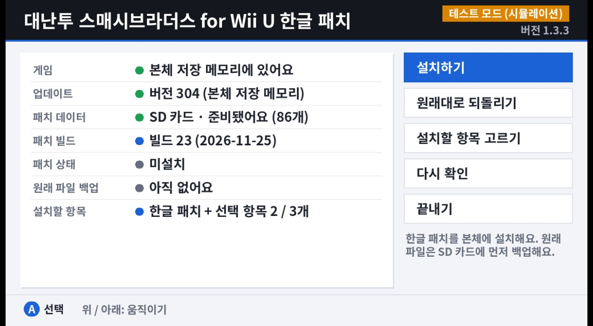 | 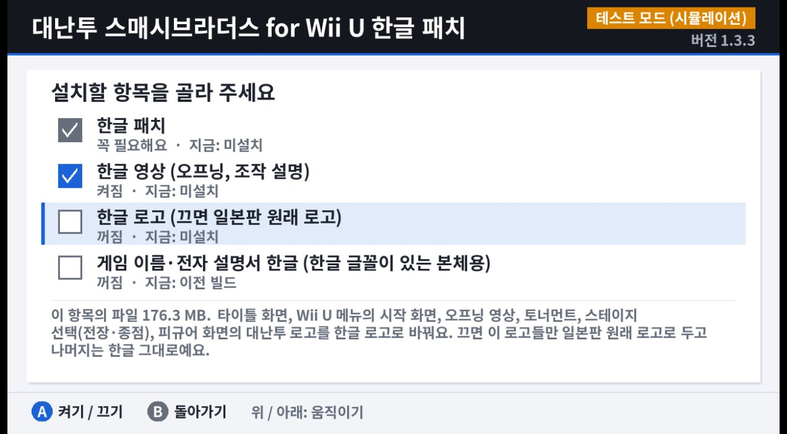 |
| 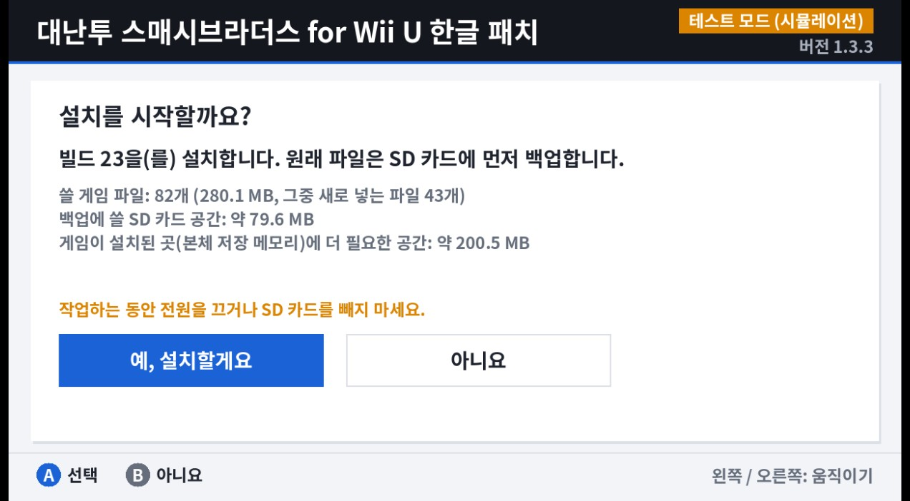 | 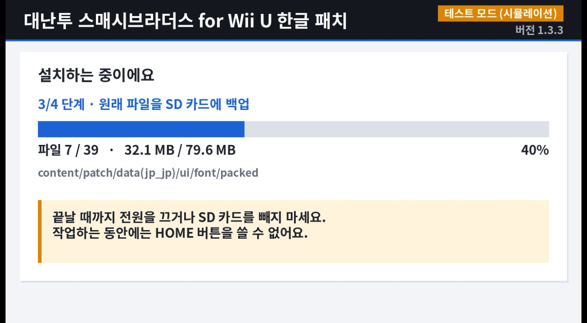 |
| 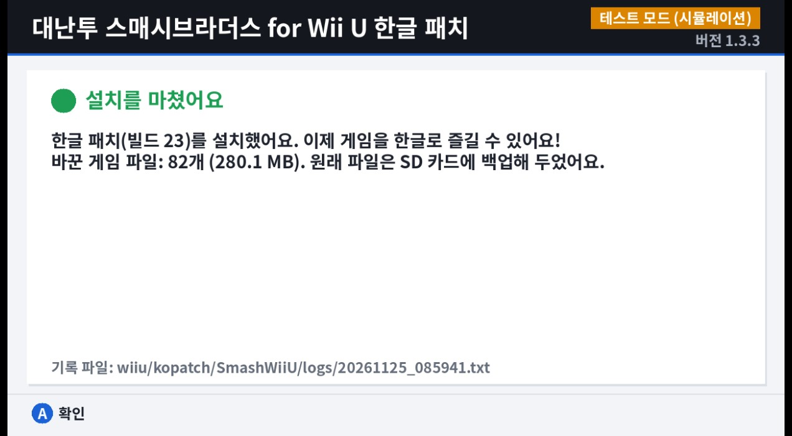 | 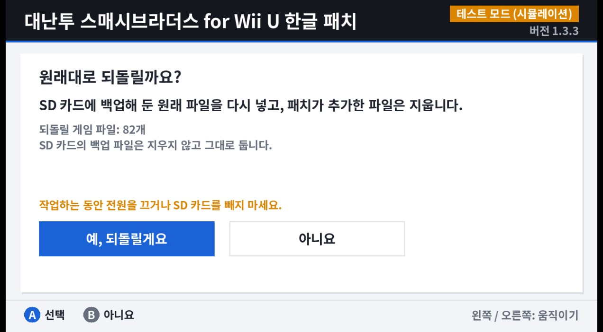 |

설치 앱 1.3.3(빌드 23)을 PC의 모의 본체(Cemu)에서 실행한 화면이라 오른쪽 위에 「테스트 모드」가 보입니다.

### 새로 추가: USB에서 설치

SD 카드가 작으면 패치 파일(약 460MB)을 USB 메모리나 USB 하드에 담아 설치할 수 있습니다.

1. Wii U ZIP의 `SD카드에 복사/wiiu` 안에서 `apps` 폴더만 SD 카드의 `wiiu` 폴더에 복사합니다.
2. 같은 곳의 `kopatch`와 `sdcafiine` 폴더를 USB 맨 위 `wiiu` 폴더 안에 복사합니다.
3. USB를 Wii U에 꽂고 켭니다. 「포맷하시겠습니까?」 같은 안내가 나오면 반드시 「취소」를 고릅니다.
4. 설치 앱의 「패치 데이터」에 「패치용 USB(FAT32)」처럼 나오면 평소처럼 설치합니다.

- USB는 PC에서 쓰는 FAT32 또는 exFAT 형식이어야 합니다(Wii U 게임 설치용으로 포맷한 USB가 아닙니다). 게임 설치용 USB와 함께 꽂아도 됩니다.
- 앱은 USB를 읽기만 합니다. 원래 파일 백업과 기록은 SD 카드에 저장합니다.
- SD 카드와 USB 양쪽에 패치 데이터가 있으면 어느 쪽을 쓸지 고르는 화면이 나옵니다.

### 기존 방식도 그대로 쓸 수 있습니다

- **SDCafiine**: 위 방법 2. 본체 파일을 바꾸지 않으므로 SD 카드를 빼면 원래대로 돌아갑니다(늘 한글 로고, Wii U 메뉴 시작 화면·게임 이름·설명서는 그대로).
- **직접 복사(FTP)**: `wiiu/sdcafiine/0005000010110E00/SSB4_Korean/content` 폴더는 업데이트 폴더와 같은 구조라, 예전 판처럼 FTP로 업데이트 폴더의 `content`에 직접 넣을 수도 있습니다. 이때는 원래 파일 백업과 되돌리기를 직접 해야 하고 항목 고르기는 없습니다. 이 빌드에서 이 방법은 따로 시험하지 않았으니 가능하면 설치 앱을 쓰세요.
- **Cemu**: 아래 그래픽 팩은 Cemu의 표준 방식 그대로입니다.

## Cemu

Cemu ZIP 안의 폴더를 Cemu의 `graphicPacks`에 넣고(Cemu 메뉴 File → Open Cemu folder 안) 「Super Smash Bros. for Wii U > Mods > Korean Patch」에서 Core(DLC가 있으면 Core + DLC)와 원하면 Opening movie를 켭니다.

### 일본판 로고 팩 만들기 (Cemu 도우미 p2)

Cemu에서도 Wii U 설치 앱처럼 「일본판 로고」를 고를 수 있습니다. 로고 그림은 다른 한글 그림과 같은 파일에 들어 있어 빼기만 하면 한글도 사라지므로, 이 도구가 **내 PC에서 내 게임 파일로** 일본판 로고 팩을 만듭니다. 예전 「패치 제작기 p1」을 빌드 23에 맞게 고친 것입니다.

1. Cemu ZIP을 「모두 압축 풀기」 한 뒤 `SSB4_Cemu_LogoTool_p2\일본판_로고_팩_만들기.cmd`를 실행합니다.
2. 도구가 Cemu 설정과 게임(Cemu에 설치한 게임, 게임 폴더, `.wua`)을 찾아 보여 줍니다. Enter 를 누르면 만들어서 Cemu의 `graphicPacks`에 넣습니다. Cemu에 한글 패치 팩이 없거나 예전 빌드이면 함께 넣을지 묻습니다.
3. Cemu에서 Core와 「Japanese logo (for Core)」(DLC가 있으면 Core + DLC와 「Japanese logo (for Core + DLC)」)를 함께 켭니다. 한글 로고로 돌아가려면 Japanese logo 팩만 끕니다.

- 대난투 로고(타이틀, 스테이지 선택, 피규어 메뉴·숍, 아미보 그림, 토너먼트 오프닝, 오프닝 영상)만 일본판이 되고 나머지 한글은 그대로입니다. Opening movie 팩은 켜 두어도 됩니다(오프닝은 원래 영상, 조작 설명 영상은 한글).
- 게임에서 읽은 부분과 만든 파일을 모두 확인값(SHA-256)으로 검사하고, 하나라도 다르면 아무것도 넣지 않습니다. Cemu에는 다 만든 팩만 넣고, 도구가 만들지 않은 같은 이름의 폴더는 건드리지 않습니다. 게임 파일은 읽기만 합니다.
- 도구에는 일본판 로고 그림이 들어 있지 않습니다. 만든 팩은 다른 사람에게 주지 마세요.

| 게임과 Cemu 찾기 | 한글 패치 팩 함께 넣기 |
|:---:|:---:|
| 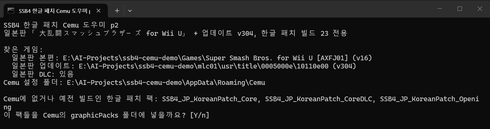 | 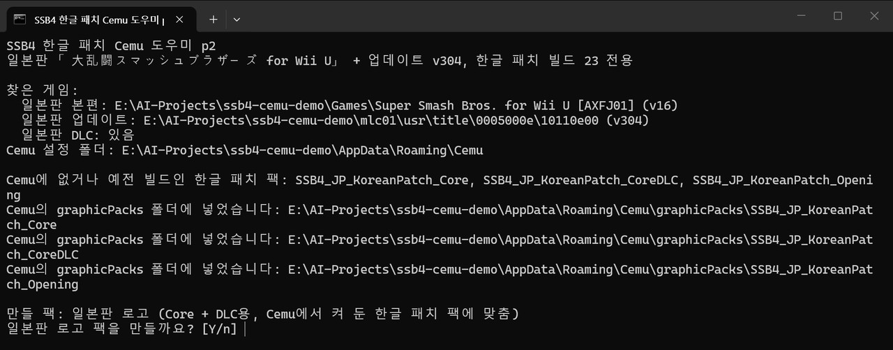 |
| 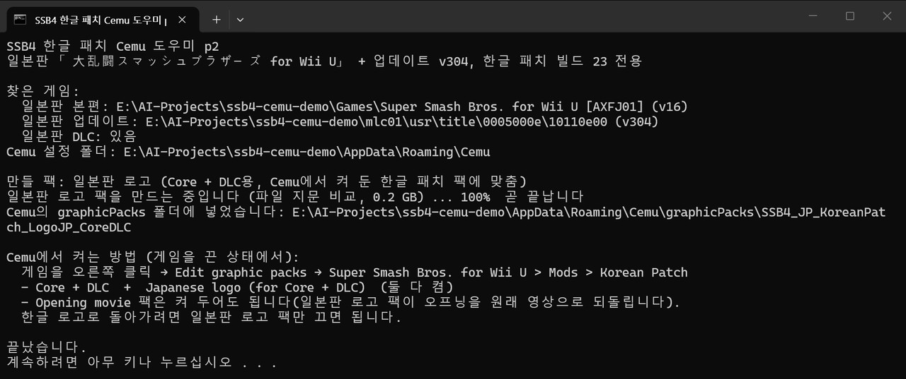 | |
| 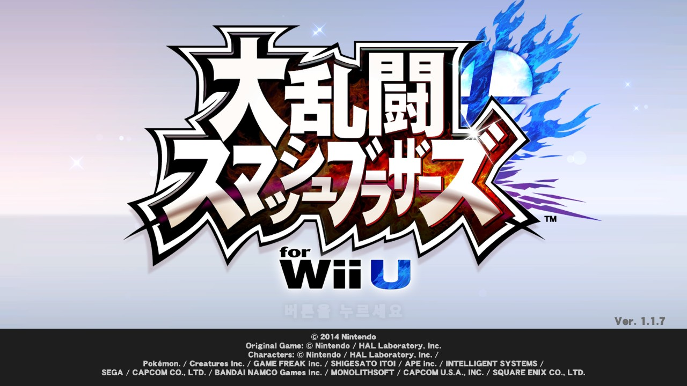 | 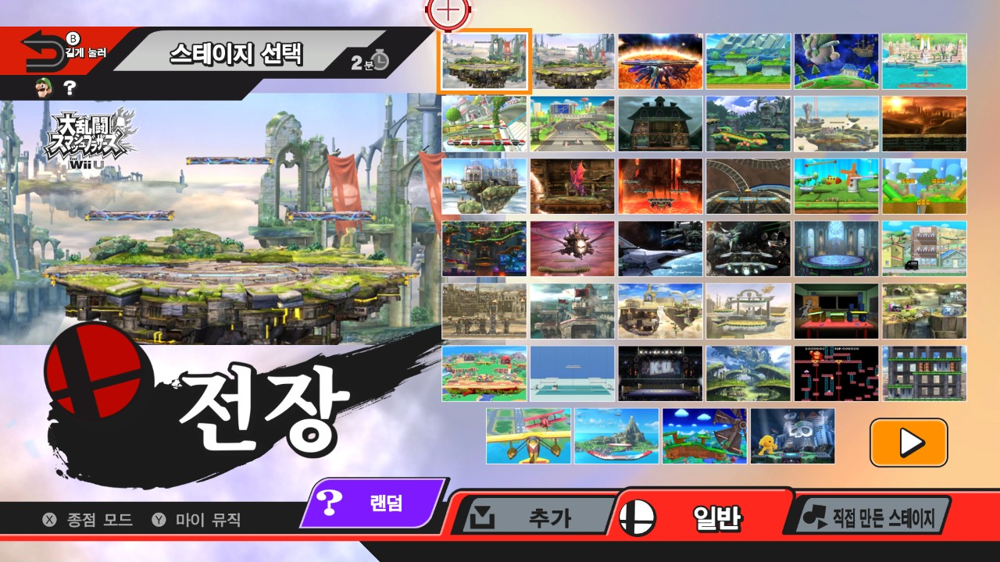 |

위: 도우미 실행 화면(시험용 폴더). 아래: Core + DLC와 Japanese logo 팩을 켠 Cemu. 로고만 일본판이고 「버튼을 누르세요」, 「전장」 등은 한글 그대로입니다.

## 확인 범위

- 실제 Wii U(Aroma)에서 빌드 15로 설치와 게임 안 한글, 시작 화면 한글 로고를 확인했습니다.
- 그 뒤에 바뀐 영상 설치, 게임 이름·전자 설명서, 일본판 로고 선택(빌드 23), USB에서 읽기는 PC 시험(모의 본체 시험, Cemu)으로만 확인했습니다.
- Cemu 일본판 로고 팩: 게임 폴더와 `.wua`에서 만들기, Cemu에 넣기를 확인했고, Cemu(Core + DLC)에서 타이틀·오프닝 영상·스테이지 선택·피규어 메뉴의 일본판 로고를 확인했습니다. Core 쪽 팩은 만든 파일의 확인값까지만 확인했습니다.
- 모든 장면의 정상 동작을 보장하지 않습니다.

## 권리 및 안내

이 프로젝트는 닌텐도 또는 원작 권리자의 허가·공인을 받지 않은 비공식 팬 패치입니다. 게임, 캐릭터, 상표의 권리는 각 권리자에게 있습니다. 패치는 어떠한 보증 없이 제공되며, 사용과 설치에 따른 결과는 사용자에게 있습니다. 설치 앱의 오픈소스 라이선스는 묶음의 `licenses` 폴더에 있습니다.
