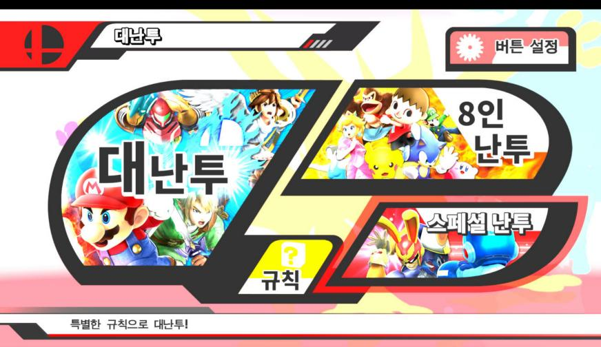

# 대난투 스매시브라더스 for Wii U 한글 패치

일본판 『大乱闘スマッシュブラザーズ for Wii U』(AXFJ01, 타이틀 ID `0005000010110E00`, 업데이트 v304)를 위한 비공식 팬 한글 패치입니다.

**최신: 빌드 23** · [릴리스 다운로드](https://github.com/auseong325-design/ssb-for-wiiu-korean-patch/releases/latest)

| | |
|:---:|:---:|
|  |  |
|  |  |

## 한글화 범위

- 게임 안의 문장, 메뉴·버튼 그림 속 글자를 한국어로 바꿨습니다. 대난투 로고는 한글 로고입니다.
- 오프닝 영상의 로고 장면과 조작 설명 영상의 이름을 한글로 바꿨습니다(선택).
- Wii U 메뉴의 시작 화면을 한글 로고로, 게임 이름과 전자 설명서를 한국어로 바꿀 수 있습니다(게임 이름·설명서는 선택, 한글 시스템 글꼴이 있는 본체용).
- 음성은 일본어 그대로입니다. DLC가 있어도, 없어도 씁니다.

## 다운로드

| 파일 | 내용 |
|---|---|
| `SmashWiiU_Korean_build23_WiiU.zip` | Wii U 본체용(Aroma). 설치 앱, SDCafiine용 파일, 안내서, 라이선스 |
| `SmashWiiU_Korean_build23_Cemu.zip` | Cemu 그래픽 팩 (Core / Core + DLC / 영상) |

압축을 푼 뒤 안에 있는 `읽어주세요.txt`(Wii U) 또는 `설치 안내.txt`(Cemu)를 따라 주세요. 게임 본편과 업데이트는 들어 있지 않습니다.

## Wii U 설치

필요한 것: [Aroma](https://wiiu.hacks.guide/)가 설치된 Wii U, SD 카드, 일본판 게임과 업데이트 v304.

| 방법 | 설명 |
|---|---|
| 1. 전용 설치 앱 | SD 카드에 `wiiu` 폴더를 복사하고 Wii U 메뉴의 「Smash Wii U KR Patch」를 실행합니다. 원래 파일을 SD 카드에 백업한 뒤 업데이트 폴더의 파일을 바꾸며, 같은 앱에서 원래대로 되돌릴 수 있습니다. 패치 파일은 USB 저장 장치(FAT32/exFAT)에 담아도 됩니다. |
| 2. SDCafiine | 본체 파일을 바꾸지 않고 SD 카드의 한글 파일을 읽게 합니다. 디스크판은 이 방법을 씁니다. |

- 설치 앱의 항목에서 한글 영상, 「한글 로고」(끄면 일본판 원래 로고), 게임 이름·전자 설명서를 고를 수 있습니다.
- 일본판 로고는 설치 앱이 본체에 설치된 게임 본편의 파일로 만들어 씁니다. 게임 본편이 디스크로만 있으면 고를 수 없습니다.
- 이전 빌드에서 업데이트할 때는 되돌릴 필요 없이 새 `wiiu` 폴더를 덮어쓰고 「설치하기」를 고르면 됩니다.

## Cemu

ZIP 안의 폴더를 Cemu의 `graphicPacks`에 넣고 「Super Smash Bros. for Wii U > Mods > Korean Patch」에서 Core(DLC가 있으면 Core + DLC)와 원하면 Opening movie를 켭니다.

## 확인 범위

- 실제 Wii U(Aroma)에서 빌드 15로 설치와 게임 안 한글, 시작 화면 한글 로고를 확인했습니다.
- 그 뒤에 바뀐 영상 설치, 게임 이름·전자 설명서, 일본판 로고 선택(빌드 23), USB에서 읽기는 PC 시험(모의 본체 시험, Cemu)으로만 확인했습니다.
- 모든 장면의 정상 동작을 보장하지 않습니다.

## 권리 및 안내

이 프로젝트는 닌텐도 또는 원작 권리자의 허가·공인을 받지 않은 비공식 팬 패치입니다. 게임, 캐릭터, 상표의 권리는 각 권리자에게 있습니다. 패치는 어떠한 보증 없이 제공되며, 사용과 설치에 따른 결과는 사용자에게 있습니다. 설치 앱의 오픈소스 라이선스는 묶음의 `licenses` 폴더에 있습니다.
