# 패치 로그

## 빌드 23 (2026-11-25) — GitHub 첫 릴리스

이전에 나눈 판 **r10(2026-10-07)** 과 비교해 바뀐 점입니다. 빌드 번호는 설치 앱이 쓰는 패치 번호로, 이번 판부터 이 번호로 부릅니다.

### 1. 전용 설치 앱 (Aroma)

r10은 FTP로 업데이트 폴더에 파일을 직접 복사하는 방식이었습니다. 이제 Wii U에서 실행하는 설치 앱이 있습니다.

- 원래 파일을 SD 카드에 백업한 뒤 바꾸고, 같은 앱에서 「원래대로 되돌리기」를 할 수 있습니다.
- 새 판이 나오면 되돌리지 않고 그대로 업데이트합니다(바뀐 파일만 바꿈).
- 설치할 항목을 고를 수 있습니다: 한글 영상, 한글 로고(끄면 일본판 원래 로고), 게임 이름·전자 설명서.
- 패치 파일을 USB 저장 장치(FAT32/exFAT)에 담아 설치할 수도 있습니다.
- 「한글 로고」를 끈 일본판 로고 파일은 설치 앱이 본체에 설치된 게임 본편의 파일로 만들어 씁니다(빌드 23). 게임 본편이 디스크로만 있으면 고를 수 없습니다.
- 본체 파일을 바꾸지 않는 SDCafiine 방식도 그대로 들어 있습니다.

| 상태 화면 | 설치 항목 |
|:---:|:---:|
| 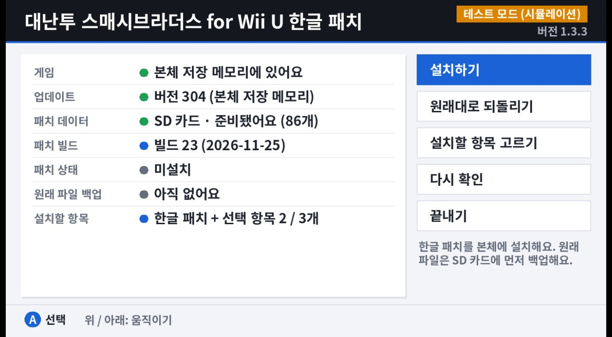 | 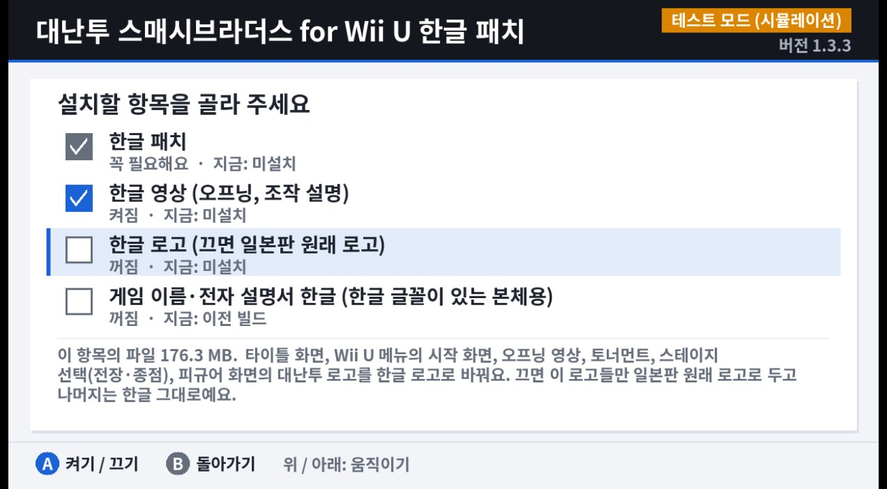 |

PC의 모의 실행 화면이라 오른쪽 위에 「테스트 모드」가 보입니다.

### 2. 한글 타이틀 로고

타이틀 화면, 오프닝에서 타이틀로 넘어가는 장면, 토너먼트 오프닝, 스테이지 선택(전장·종점), 피규어 화면의 대난투 로고를 한글 로고로 바꿨습니다.

| 타이틀 | Wii U 메뉴 시작 화면 |
|:---:|:---:|
| 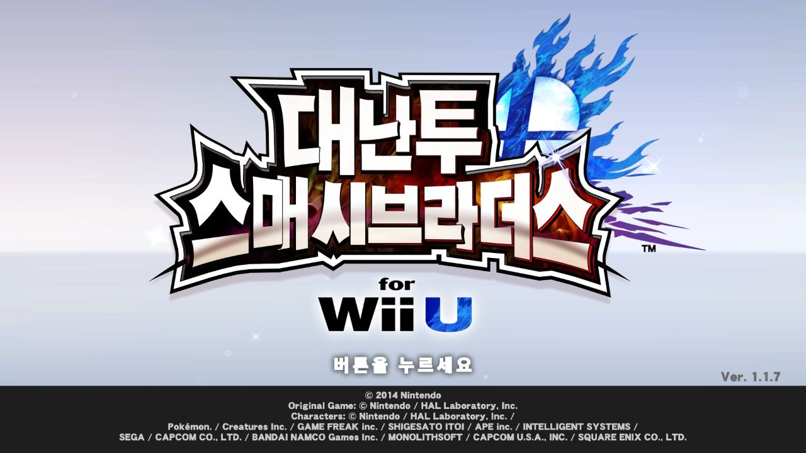 | 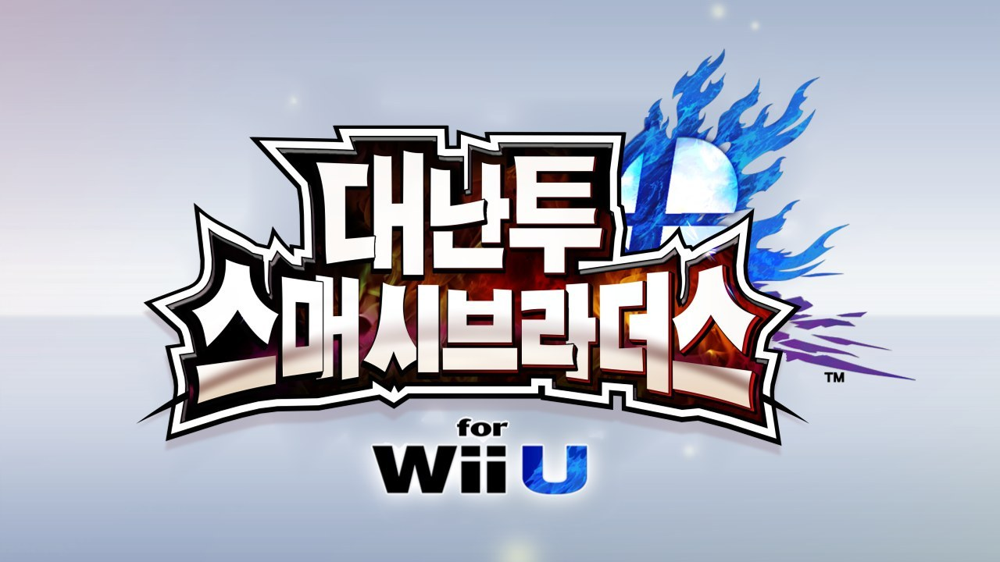 |

Wii U 메뉴에서 게임을 시작할 때 TV·GamePad에 나오는 화면도 한글 로고입니다(설치 앱 방식).

### 3. 한글 영상 (선택)

- 오프닝 영상의 로고 두 장면을 한글 로고로 다시 만들었습니다. 나머지 장면과 음성은 원본 그대로입니다.
- 조작 설명 영상에 들어 있던 전투 화면 이름(MARIO/KOOPA)을 게임과 같은 「마리오」「쿠파」로 바꿨습니다.

| 오프닝 | 조작 설명 |
|:---:|:---:|
| 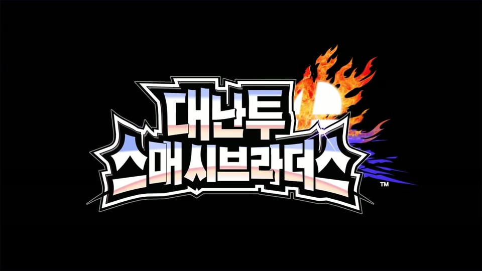 | 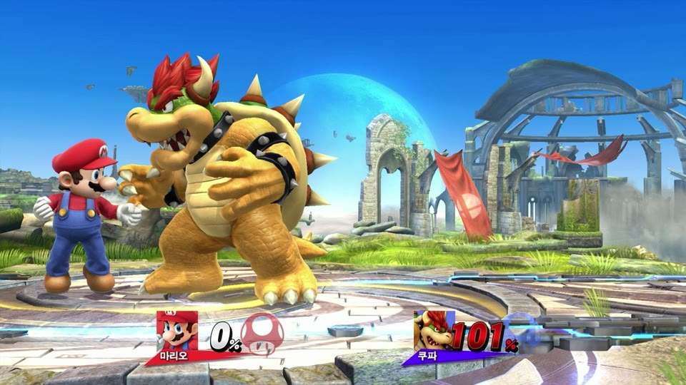 |

### 4. 게임 이름·전자 설명서 (선택)

Wii U 메뉴·HOME 메뉴의 게임 이름을 「대난투 스매시브라더스 for Wii U」로, HOME 메뉴에서 여는 전자 설명서 43쪽을 한국어판으로 바꿨습니다. 한국어판 3DS 공식 설명서 문장과 게임 용어를 우선했습니다. 본체 시스템 글꼴로 그려지므로 한글 글꼴이 있는 본체에서만 켜세요.

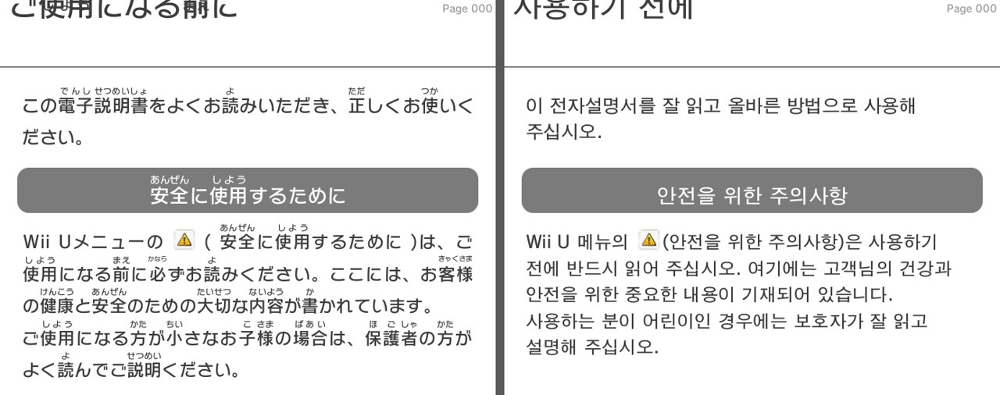

PC에서 그린 미리보기입니다. 실제 Wii U에서 연 화면은 아직 확인하지 않았습니다.

### 5. 번역 전체 재검토

「한국닌텐도가 Wii U판을 정발했다면」을 기준으로 문장 16,119행을 다시 읽고 220건을 따져 반영했습니다.

- 오역·비문·맞춤법 수정.
- 한국어판 3DS 공식 용어로 통일: 축적 대미지, 서든데스, 협력 난투, 시합, 격퇴, 던지기 도구 등.
- 이름 표기: 더블 대시, 익사이트, 갤러그, 나츄레 등. 한국어판 3DS에 공식 이름이 있으면 그것을, 없으면 얼티밋 공식 이름을 씁니다.
- 한국어판 3DS 공식 문장의 사실 오류 23행 교정, 3DS 공식 문장과 대조해 92행 반영.
- DLC 파이터의 팁 문장을 한국어판 3DS 공식 문장 기준으로 맞추고, 승리 화면 이름 6행을 로마자로 바꿨습니다.

| 피규어 메뉴 | 스매시 팁 |
|:---:|:---:|
| 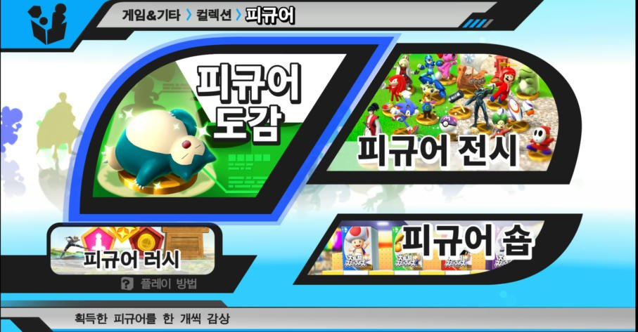 | 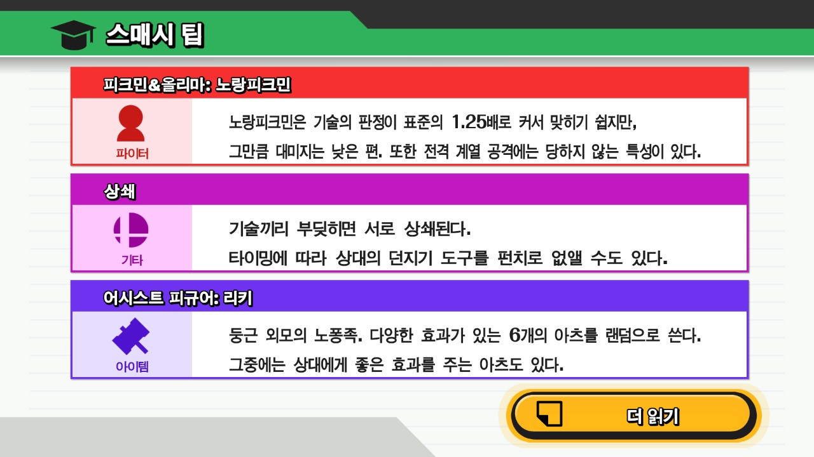 |
| 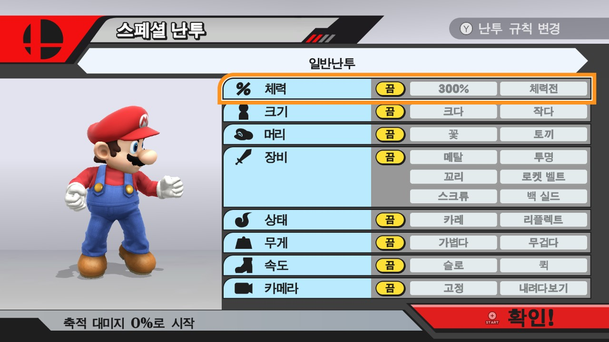 | 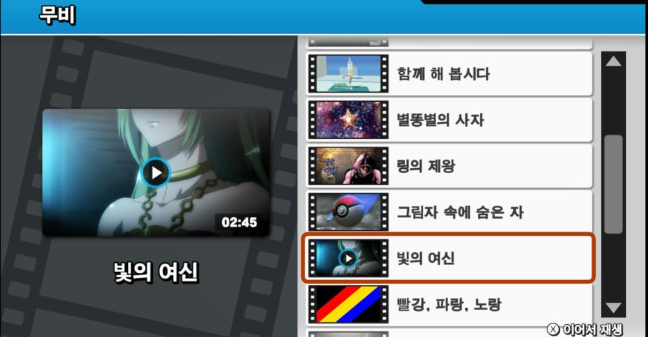 |
| 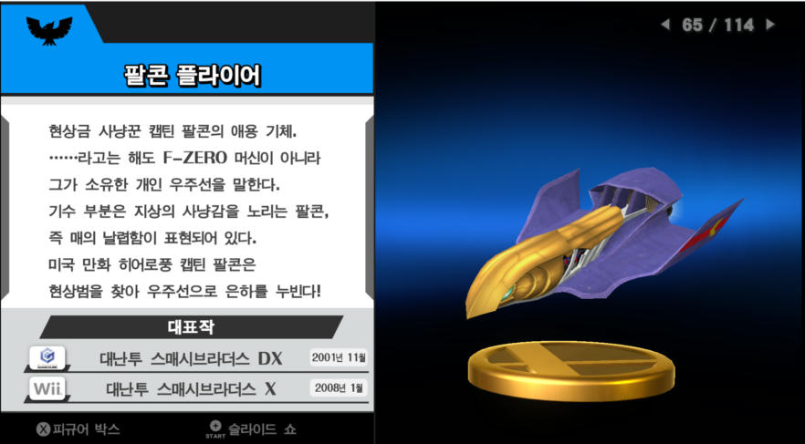 | 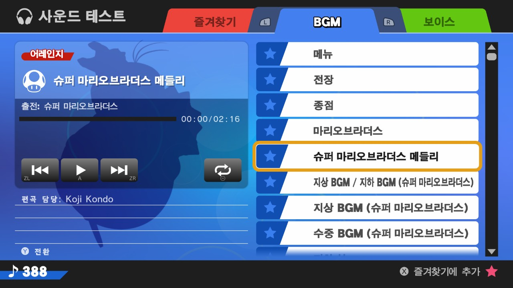 |

### 6. 그림

- 원작 게임 로고 35장: 한국어 공식 로고가 있으면 그것으로(칼로스 포켓몬리그, 동물의 숲 두 곳), 없으면 영문판 로고로 바꿨습니다.
- 3DS 연결 화면의 3DS 패키지를 한국판 패키지 그림으로 바꿨습니다.
- 아미보 화면의 대난투 로고(설명 그림, 마리오 아미보 패키지)를 한글 로고로 바꿨습니다.
- 「오더」 모드의 이름을 일본판 원문대로 「마스터 사이드」「크레이지 사이드」로 통일했습니다(메뉴 그림 포함).

| 스테이지 선택 (칼로스) | 3DS 연결 화면 |
|:---:|:---:|
| 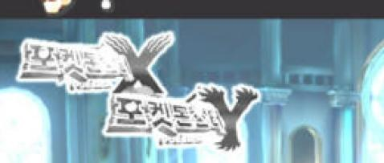 | 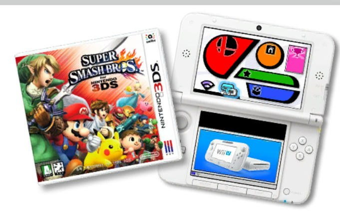 |
| 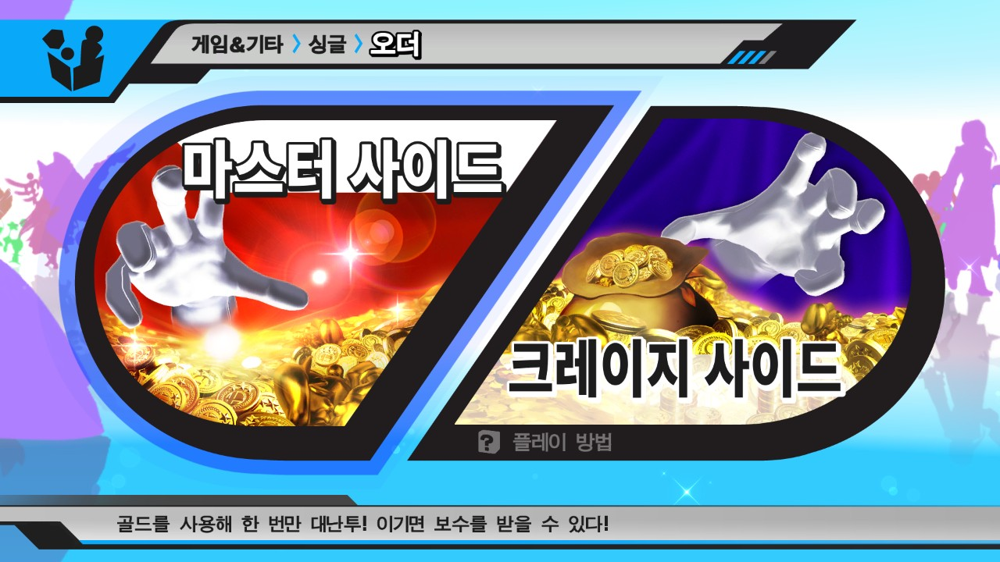 | 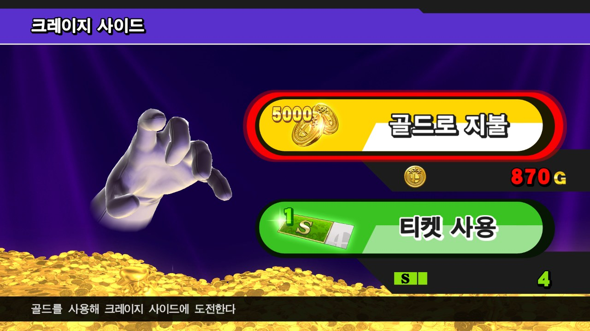 |

### 확인 범위

- 실제 Wii U(Aroma)에서 빌드 15로 설치와 게임 안 한글, 시작 화면 한글 로고를 확인했습니다.
- 그 뒤에 바뀐 영상 설치, 게임 이름·전자 설명서, 일본판 로고 선택, USB에서 읽기는 PC 시험(모의 본체 시험, Cemu)으로만 확인했습니다.
- 화면은 Cemu에서 찍은 것입니다(전자 설명서는 PC 미리보기).
